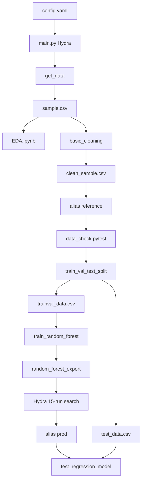

# NYC short-term rental price  pipeline

This repository estimates the nightly price of a New York City short-term rental from listing features. A property company receives a new bulk sample every week, so the same steps have to run again without hand-editing notebooks.

Hydra reads [config.yaml](config.yaml). MLflow runs each step in its own Conda environment. Weights & Biases project `nyc_airbnb` stores datasets, the exported model, and validation MAE. GitHub is the only source-control and release host.

- W&B project: https://wandb.ai/dharacoding-dhara-coding/nyc_airbnb
- GitHub repository: https://github.com/mynamerahulkumar/UcityBuild_ml_pipeline_short_term_rental_Price
- Release 1.0.0: https://github.com/mynamerahulkumar/UcityBuild_ml_pipeline_short_term_rental_Price/releases/tag/1.0.0
- Release 1.0.1: https://github.com/mynamerahulkumar/UcityBuild_ml_pipeline_short_term_rental_Price/releases/tag/1.0.1

The step-by-step rubric checklist is in [startup.md](startup.md). This file is the map of how the code fits together and how to run it.

## Architecture



`EDA.ipynb` sits beside the pipeline. It reads `sample.csv:latest` and records cleaning decisions. It does not upload `clean_sample.csv`. The reusable cleaning step does that.

`data_check` does not create a new dataset. It reads `clean_sample.csv:latest` and `clean_sample.csv:reference`. A failed pytest stops MLflow, so later steps do not train on bad data.

`test_regression_model` is implemented in [main.py](main.py) and is left commented out of the default `_steps` list. A full `mlflow run .` therefore stops after training. The test step runs only when you pass `steps=test_regression_model`, and only after some `random_forest_export` version carries the `prod` alias.

## Stack and environments

| Piece | Role | Where |
| --- | --- | --- |
| Hydra | Reads `config.yaml` and runs the hyperparameter grid | [main.py](main.py), [config.yaml](config.yaml) |
| MLflow | Launches each step with `env_manager="conda"` and stores the sklearn pipeline | root [MLproject](MLproject) and each component `MLproject` |
| Weights & Biases | Artifacts, run config, validation MAE, feature-importance plot | project `nyc_airbnb` |
| scikit-learn | Imputers, encoders, TF-IDF, `RandomForestRegressor` | [src/train_random_forest/run.py](src/train_random_forest/run.py) |
| pytest | Data contracts | [src/data_check/test_data.py](src/data_check/test_data.py) |

Three environment layers stay separate:

- [environment.yml](environment.yml) creates `nyc_airbnb_dev` (Python 3.13). Use this environment to edit the project and to invoke `mlflow run`.
- The root [conda.yml](conda.yml) is the environment MLflow builds for the parent `mlflow run .` process.
- Every step has its own `conda.yml`. MLflow builds that environment the first time the step runs. [src/eda/conda.yml](src/eda/conda.yml) stays on Python 3.12 because `ydata-profiling` needs it, and it pins `setuptools==70.3.0` so `pkg_resources` still imports.

On this Apple Silicon Mac the Anaconda install at `/opt/anaconda3` cannot execute. [scripts/run_pipeline.sh](scripts/run_pipeline.sh) points MLflow at Homebrew Miniforge:

```bash
export MLFLOW_CONDA_HOME=/opt/homebrew/Caskroom/miniforge/base
export CONDA_EXE="$MLFLOW_CONDA_HOME/bin/conda"
```

[scripts/wandb_env.sh](scripts/wandb_env.sh) loads `WANDB_API_KEY` from a gitignored `.env` line `wandb_api_key=...` when the variable is not already set. The key is never written into the repository.

## Repository layout

```text
.
├── main.py                      # Hydra entry point; calls mlflow.run for each step
├── config.yaml                  # All pipeline parameters
├── MLproject                    # mlflow run .  (steps, hydra_options)
├── EDA.ipynb                    # Root notebook required by the rubric
├── components/
│   ├── get_data/                # sample1.csv / sample2.csv -> sample.csv
│   ├── train_val_test_split/    # clean_sample.csv -> trainval + test
│   ├── test_regression_model/   # prod model scored on the test artifact
│   └── wandb_utils/             # log_artifact helper used by the components
└── src/
    ├── basic_cleaning/          # sample.csv -> clean_sample.csv
    ├── data_check/              # pytest contracts
    ├── eda/                     # JupyterLab launcher and its conda.yml
    └── train_random_forest/     # train, export, upload random_forest_export
```

## Main code flow

`mlflow run .` executes the root [MLproject](MLproject) command:

```text
python main.py main.steps='<steps>' $(echo <hydra_options>)
```

Hydra calls `go()` in [main.py](main.py). Before any step:

1. `WANDB_PROJECT` is set from `config["main"]["project_name"]` (`nyc_airbnb`).
2. `WANDB_RUN_GROUP` is set from `config["main"]["experiment_name"]` (`development`).
3. `config["main"]["steps"]` is split on commas. The value `all` expands to `_steps`: `download`, `basic_cleaning`, `data_check`, `data_split`, `train_random_forest`.
4. Component directories are built from `hydra.utils.get_original_cwd()`. Hydra changes the process working directory to an `outputs/` or `multirun/` folder, so a relative path such as `components/get_data` would miss the repository.

Each active step is one `mlflow.run(..., env_manager="conda")`. MLflow failure is raised, so a failed data test aborts the rest of the pipeline.

Parameters are read from [config.yaml](config.yaml). Nothing in the step calls is hard-coded except artifact names and aliases:

| Config key | Used by | Current value |
| --- | --- | --- |
| `etl.sample` | download | `sample1.csv` |
| `etl.min_price`, `etl.max_price` | cleaning and data tests | 10 and 350 |
| `data_check.kl_threshold` | neighbourhood KL test | 0.2 |
| `modeling.test_size` | outer split | 0.2 |
| `modeling.val_size` | split inside training | 0.2 |
| `modeling.random_seed` | both splits and the forest | 42 |
| `modeling.stratify_by` | both splits | `neighbourhood_group` |
| `modeling.max_tfidf_features` | TF-IDF on the listing `name` | 30 |
| `modeling.random_forest.*` | `RandomForestRegressor` | written to `rf_config.json` |

Before training, `go()` dumps `config["modeling"]["random_forest"]` to `rf_config.json` and passes that absolute path as `rf_config`. The training script adds `random_state` from `random_seed` and logs the dict on the W&B run.

## Step by step

### 1. Download

[components/get_data/run.py](components/get_data/run.py) does not fetch a URL. It copies the file named by `etl.sample` from `components/get_data/data/` and uploads it as artifact `sample.csv` of type `raw_data`.

- `sample1.csv` is the 20,000-row sample used to build release 1.0.0.
- `sample2.csv` is the later weekly sample used to test releases 1.0.0 and 1.0.1.

### 2. Exploratory notebook

[EDA.ipynb](EDA.ipynb) starts a W&B run in group `eda` with `save_code=True`, downloads `sample.csv:latest`, and uses `ydata-profiling` plus pandas and matplotlib.

Cleaning decisions recorded in the notebook, and checked against [notes.md](notes.md):

- Keep nightly prices in the inclusive range `$10 <= price <= $350`.
- Parse `last_review` as a datetime.
- Do not impute or drop missing values. Review fields are often empty because the listing has no reviews. The saved sklearn pipeline fills those gaps at fit time and at prediction time, so training and production use the same rules.

The notebook inspects latitude and longitude. The geographic drop itself lives in `basic_cleaning`, added in release 1.0.1.

### 3. Basic cleaning

[src/basic_cleaning/run.py](src/basic_cleaning/run.py) accepts `input_artifact`, `output_artifact`, `output_type`, `output_description`, `min_price`, and `max_price`. Artifact fields are strings. Prices are floats. The same names and types are declared in [src/basic_cleaning/MLproject](src/basic_cleaning/MLproject). Pandas is pinned in [src/basic_cleaning/conda.yml](src/basic_cleaning/conda.yml).

The function:

1. Downloads the input artifact with `run.use_artifact`, which records lineage.
2. Keeps rows whose price is between `min_price` and `max_price`.
3. Converts `last_review` with `pd.to_datetime`.
4. Keeps rows with longitude in [-74.25, -73.50] and latitude in [40.5, 41.2].
5. Writes `clean_sample.csv` with `index=False` and logs it. An index column would break `test_column_names`.

The logger reports the row counts dropped by the price filter and by the bounding box. Release 1.0.0 contains steps 1–3 and 5 only. The bounding-box lines are the 1.0.1 commit.

### 4. Data tests

[src/data_check/conftest.py](src/data_check/conftest.py) downloads `--csv` and `--ref` inside session fixtures. [src/data_check/test_data.py](src/data_check/test_data.py) then runs:

| Test | Contract |
| --- | --- |
| `test_column_names` | The 16 expected columns, in order |
| `test_neighborhood_names` | Bronx, Brooklyn, Manhattan, Queens, Staten Island |
| `test_proper_boundaries` | Every row inside the NYC box |
| `test_similar_neigh_distrib` | KL divergence of `neighbourhood_group` versus the reference, base 2, below `kl_threshold` |
| `test_row_count` | `15000 < rows < 1000000` |
| `test_price_range` | Every price is between `min_price` and `max_price` |

`test_row_count` and `test_price_range` are the two tests added for the rubric. The fixtures require the argument names `data`, `min_price`, and `max_price`.

The `reference` alias must already exist. On the first sample it points at the same version as `latest`. On a later sample, `latest` moves and `reference` stays, so the KL test compares the new week with the original cleaned sample.

### 5. Split

[components/train_val_test_split/run.py](components/train_val_test_split/run.py) reads `clean_sample.csv:latest`, stratifies on `neighbourhood_group` unless `stratify_by` is `none`, and uploads:

- `trainval_data.csv` (80 percent with `test_size` 0.2)
- `test_data.csv` (the held-out 20 percent)

The test file is not used again until `test_regression_model`.

### 6. Train the random forest

[src/train_random_forest/run.py](src/train_random_forest/run.py) downloads `trainval_data.csv:latest`, separates `price`, and splits again with `val_size` so MAE is computed on data the forest did not fit.

`get_inference_pipeline` builds two named objects the rubric asks for:

- `non_ordinal_categorical_preproc`: `SimpleImputer(strategy="most_frequent")` then `OneHotEncoder()` for `neighbourhood_group`.
- `sk_pipe`: a `Pipeline` with steps `preprocessor` and `random_forest`.

The preprocessor is a `ColumnTransformer`:

- `room_type` goes through `OrdinalEncoder` (entire home, private room, shared room). It is not imputed. The listing site requires a room type.
- `neighbourhood_group` uses the imputer and one-hot encoder above.
- Counts and coordinates (`minimum_nights`, reviews, host listings, availability, longitude, latitude) are filled with 0.
- Missing `last_review` becomes `2010-01-01`, then a day-delta from the newest date in the column.
- `name` is filled with an empty string and passed to `TfidfVectorizer` with `max_features=max_tfidf_features`.

`sparse_threshold=0` forces a dense matrix. `TfidfVectorizer` emits a sparse matrix, and this scikit-learn `RandomForestRegressor` rejects sparse input. The step names stay `preprocessor` and `random_forest`.

`go()` then fits `sk_pipe` on the training rows, scores the validation rows, saves the pipeline with `mlflow.sklearn.save_model` into `random_forest_dir`, and uploads that directory as a W&B artifact named `random_forest_export`, type `model_export`, with the forest config as metadata. Validation `r2` and `mae` are written to `run.summary`. A feature-importance figure is logged as a W&B image.

Imputation lives inside this pipeline on purpose. A new listing with a missing review date or neighbourhood is transformed by the same fitted steps that training used.

### 7. Hyperparameter search, prod alias, and test

The search changes only two config fields, 3 by 5 equals 15 runs, and it retrains without redoing download or cleaning:

```text
modeling.max_tfidf_features = 10, 15, 30
modeling.random_forest.max_features = 0.1, 0.33, 0.5, 0.75, 1
```

The model with the lowest validation MAE is the one that receives the `prod` alias. Test MAE is not used to choose it.

On sample1 that run is W&B run `zyzw136a`: `max_tfidf_features=30`, `max_features=0.33`, validation MAE **33.80**. Those two values are the defaults now stored in [config.yaml](config.yaml). The artifact is `random_forest_export:v12`.

[components/test_regression_model/run.py](components/test_regression_model/run.py) loads `random_forest_export:prod` with `mlflow.sklearn.load_model`, predicts on `test_data.csv:latest`, and logs test MAE. The held-out MAE is **33.29**. Validation and test error differ by about half a dollar, so the selected forest is not overfitting the validation split.

### 8. Lineage

W&B links each artifact to the run that logged it and to the artifacts that run consumed. For `random_forest_export:prod` the chain is:

```text
sample.csv:v0
    download_file
clean_sample.csv:v0
    basic_cleaning
trainval_data.csv:v0
    train_val_test_split
random_forest_export:v12
    train_random_forest
```

`data_check` uses `clean_sample.csv` and does not log a new file, so it appears as a consumer of the cleaned artifact rather than as a node that produces the model. `test_data.csv` is the other output of the same split run.

Open the lineage in the UI from the `prod` alias:

https://wandb.ai/dharacoding-dhara-coding/nyc_airbnb/artifacts/model_export/random_forest_export/v12

## Artifacts and aliases

| Artifact | Type | Meaning |
| --- | --- | --- |
| `sample.csv` | `raw_data` | Raw sample selected by `etl.sample` |
| `clean_sample.csv` | `clean_sample` | Price filter, datetime conversion, and, since 1.0.1, the NYC box |
| `trainval_data.csv` | `trainval_data` | Rows used to fit and to compute validation MAE |
| `test_data.csv` | `test_data` | Held-out rows |
| `random_forest_export` | `model_export` | MLflow sklearn directory |

Aliases that the rubric checks:

- `clean_sample.csv:reference` is version `v0`, the first cleaned sample1. It is not moved when sample2 is cleaned.
- `clean_sample.csv:latest` follows the newest cleaning run. After the 1.0.1 sample2 run that is `v2`.
- `random_forest_export:prod` is version `v12`, the sample1 model with validation MAE 33.80.
- `random_forest_export:latest` follows the newest training run. The 1.0.1 sample2 run logged `v16`. The `prod` alias was left on `v12`.

## Releases

| Tag | Commit | What the code does | What happened when it ran |
| --- | --- | --- | --- |
| `1.0.0` | `dfd430d` | Price filter and datetime conversion. No geographic drop. Defaults are the best sample1 hyperparameters. | `mlflow run` of this tag with `etl.sample='sample2.csv'` failed `test_proper_boundaries`. One of 46,428 price-valid rows was outside the NYC box (`np.sum(~idx)` was 1). The other five tests passed. |
| `1.0.1` | `fb06810` | Same cleaning, plus the longitude/latitude filter immediately before `to_csv`. | The same remote command passed all six tests, dropped that one row, and uploaded `random_forest_export:v16` with validation MAE 31.90. |

Tag `1.0.0` was not moved. A later commit on `main` only records these measured results in the README. The release tags still point at the commits above.

## How to run

Run every command from the repository root. `scripts/run_pipeline.sh` selects Miniforge and loads `.env`.

### One-time setup

```bash
brew install miniforge
export MLFLOW_CONDA_HOME=/opt/homebrew/Caskroom/miniforge/base
export CONDA_EXE="$MLFLOW_CONDA_HOME/bin/conda"
export PATH="$MLFLOW_CONDA_HOME/bin:$PATH"
conda env create -f environment.yml
conda activate nyc_airbnb_dev
```

Put the W&B key in `.env` as `wandb_api_key=...`, or run `wandb login`. Confirm the libraries:

```bash
python scripts/check_environment.py
```

The `nyc_airbnb` project must be public so a reviewer can open it. The project access used here is `USER_READ`.

### One step or the default pipeline

```bash
# Raw sample only. Uploads sample.csv.
scripts/run_pipeline.sh -P steps=download

# Cleaning, then tests. The reference alias must exist before data_check.
scripts/run_pipeline.sh -P steps=basic_cleaning
scripts/run_pipeline.sh -P steps=data_check

# Split and train with the defaults in config.yaml.
scripts/run_pipeline.sh -P steps=data_split,train_random_forest

# Every default step. This does not run test_regression_model.
scripts/run_pipeline.sh
```

`steps=all` is the same default list. Override any Hydra field with `hydra_options`:

```bash
scripts/run_pipeline.sh \
  -P steps=basic_cleaning \
  -P hydra_options="etl.min_price=50 etl.max_price=300"
```

### EDA notebook

Headless execution with the EDA environment:

```bash
conda env create -f src/eda/conda.yml
source scripts/wandb_env.sh
export MPLBACKEND=Agg
export PATH="/opt/homebrew/Caskroom/miniforge/base/envs/eda/bin:$PATH"
jupyter nbconvert --to notebook --execute --inplace EDA.ipynb
```

`scripts/run_eda.sh` instead starts JupyterLab through `mlflow run src/eda`. Save the notebook as `EDA.ipynb` in the repository root, restart the kernel, and run all cells. That matches the checks in [notes.md](notes.md).

### Reference alias

After the first successful `basic_cleaning`, add `reference` to that `clean_sample.csv` version and leave it there. In the W&B UI this is the plus button in the Aliases section of the `latest` version. The same result from Python:

```python
import wandb
api = wandb.Api()
art = api.artifact("dharacoding-dhara-coding/nyc_airbnb/clean_sample.csv:latest")
art.aliases = sorted(set(art.aliases) | {"reference"})
art.save()
```

### Hyperparameter search

```bash
scripts/run_pipeline.sh \
  -P steps=train_random_forest \
  -P hydra_options="modeling.max_tfidf_features=10,15,30 modeling.random_forest.max_features=0.1,0.33,0.5,0.75,1 -m"
```

The trailing `-m` is Hydra's multirun flag. Sort the W&B runs by `mae` ascending. Copy the winning `max_tfidf_features` and `random_forest.max_features` into [config.yaml](config.yaml). Add the `prod` alias to that run's `random_forest_export` version, not to whichever version happens to be `latest`.

### Test the production model

```bash
scripts/run_pipeline.sh -P steps=test_regression_model
```

Compare the test `mae` on that run with the validation `mae` on the `prod` training run.

### Run a published tag

This clones the tag from GitHub and runs the default steps. Release 1.0.0 fails on `sample2.csv`. Release 1.0.1 completes and uploads a new model.

```bash
export MLFLOW_CONDA_HOME=/opt/homebrew/Caskroom/miniforge/base
export CONDA_EXE="$MLFLOW_CONDA_HOME/bin/conda"
source scripts/wandb_env.sh

mlflow run https://github.com/mynamerahulkumar/UcityBuild_ml_pipeline_short_term_rental_Price.git \
  -v 1.0.0 \
  -P hydra_options="etl.sample='sample2.csv'"

mlflow run https://github.com/mynamerahulkumar/UcityBuild_ml_pipeline_short_term_rental_Price.git \
  -v 1.0.1 \
  -P hydra_options="etl.sample='sample2.csv'"
```

Create the tags only after the matching code is committed:

```bash
git tag -a 1.0.0 -m "Initial ML pipeline release"
git push origin 1.0.0

git tag -a 1.0.1 -m "Add geographical boundary cleaning"
git push origin 1.0.1
```

Do not move an existing tag. Publish each tag as a GitHub Release. The release titles used here are `NYC Rental Price ML Pipeline 1.0.0` and `NYC Rental Price ML Pipeline 1.0.1`.
