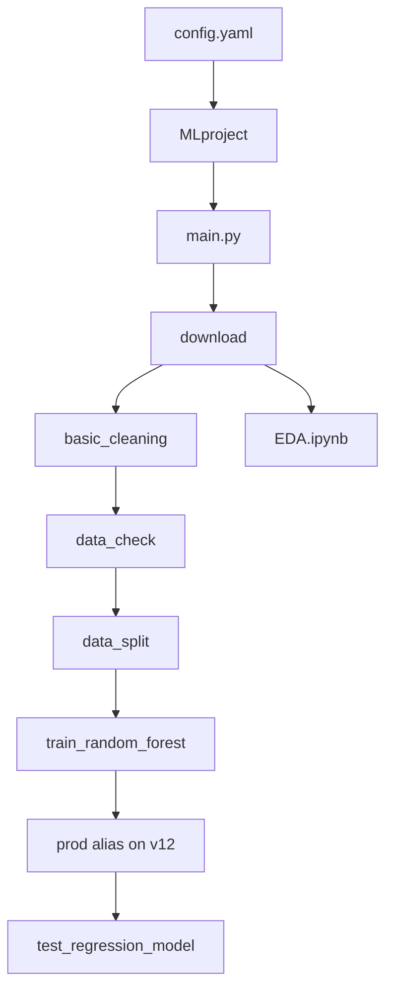
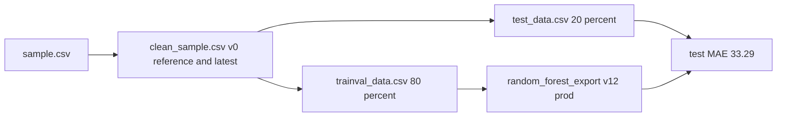
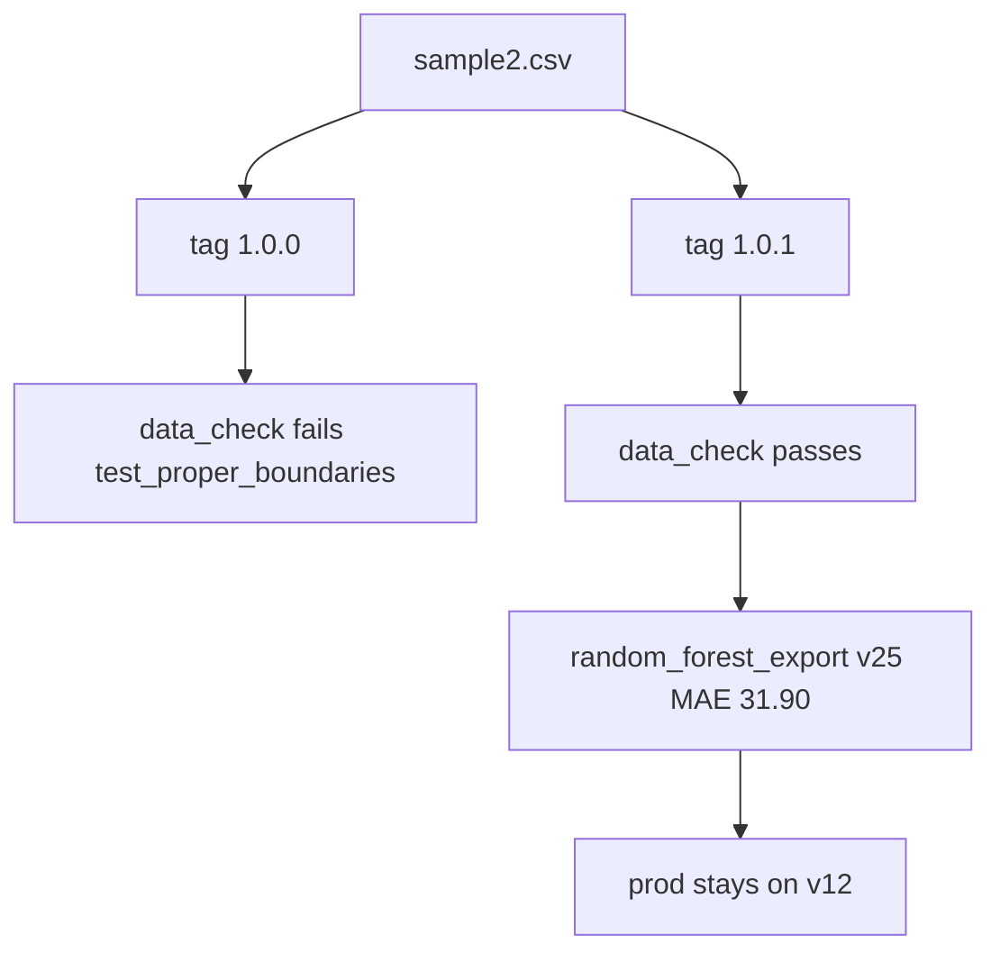

# Architecture

This project estimates the nightly price of a short-term rental in New York City. A scikit-learn random forest is trained on a sample of listings. MLflow runs each step in its own conda environment. Hydra reads [config.yaml](../config.yaml). Weights & Biases stores the datasets, the model, and the metrics.

The numbered way to run and click through W&B is in [startup.md](startup.md).

## Default flow

[MLproject](../MLproject) at the repository root starts [main.py](../main.py). `steps=all` runs five steps. `test_regression_model` stays out of that list until a model carries the `prod` alias. [EDA.ipynb](../EDA.ipynb) sits beside the pipeline: it reads `sample.csv` and records cleaning decisions, and it does not upload `clean_sample.csv`.



## Artifact flow

Each step logs a file to the public W&B project `nyc_airbnb`. The next step downloads that file with `run.use_artifact`, which is what draws the lineage graph.



`clean_sample.csv:v0` holds both `reference` and `latest`. It is the cleaned sample1 file (19,001 rows). `random_forest_export:v12` holds `prod`. Later model versions, including `:latest`, are other training runs. The selected model is v12.

## Release flow

The two Git tags are frozen copies of this repository. `mlflow run` of a tag clones that commit and runs the default steps.



## Repository layout

`components/` holds steps that shipped with the starter. `src/` holds the steps completed for this project.

```text
.
├── MLproject                  # mlflow run . starts here
├── main.py                    # chooses steps and calls mlflow.run
├── config.yaml                # Hydra configuration
├── conda.yml                  # environment for the root MLflow run
├── environment.yml            # local nyc_airbnb_dev environment
├── EDA.ipynb                  # rubric notebook, repository root
├── notes.md                   # EDA checklist
├── components/
│   ├── get_data/              # sample1.csv or sample2.csv to sample.csv
│   ├── train_val_test_split/  # clean_sample.csv to trainval and test
│   ├── test_regression_model/ # score random_forest_export:prod
│   └── wandb_utils/           # log_artifact helper
└── src/
    ├── basic_cleaning/        # sample.csv to clean_sample.csv
    ├── data_check/            # pytest against latest and reference
    ├── eda/                   # launches JupyterLab
    └── train_random_forest/   # fit, export, upload random_forest_export
```

Generated folders such as `mlruns/`, `wandb/`, `outputs/`, and `multirun/` are local run output. They are listed in `.gitignore` and are not part of the submission. The datasets and the model live in W&B.

## How main.py runs a step

Hydra loads [config.yaml](../config.yaml) because of the decorator on `go()` in [main.py](../main.py). `main.steps` defaults to `all`. That value expands to `_steps`:

```text
download, basic_cleaning, data_check, data_split, train_random_forest
```

`test_regression_model` is commented out of `_steps`. It runs only when you pass `steps=test_regression_model`, and only after some `random_forest_export` version carries `prod`.

Hydra changes the process working directory to an `outputs/` folder. `get_original_cwd()` returns the repository root, and every `mlflow.run` path is built from that root. A relative path such as `components/get_data` would miss the component.

Each call looks like this. The step directory contains its own `MLproject`. `env_manager="conda"` builds the environment from that step's `conda.yml`. Parameters come from `config`, not from numbers written into `main.py`.

```python
mlflow.run(
    os.path.join(root, "src", "basic_cleaning"),
    "main",
    env_manager="conda",
    parameters={...},
)
```

`WANDB_PROJECT` is set from `main.project_name` (`nyc_airbnb`) and `WANDB_RUN_GROUP` from `main.experiment_name` (`development`).

## Step by step

### 1. Download

[components/get_data/run.py](../components/get_data/run.py) does not fetch a URL. It copies the file named by `etl.sample` from `components/get_data/data/` and uploads it as artifact `sample.csv` of type `raw_data`.

`config.yaml` sets `etl.sample` to `sample1.csv` (20,000 rows). Release checks override that to `sample2.csv`. The artifact name stays `sample.csv` either way. Job type: `download_file`.

### 2. Exploratory notebook

[EDA.ipynb](../EDA.ipynb) starts a W&B run in group `eda`, downloads `sample.csv:latest`, and uses pandas plus `ydata-profiling`. [notes.md](../notes.md) is the checklist for that notebook.

The notebook keeps prices from 10 to 350 inclusive, converts `last_review` to datetime, and leaves missing values missing. [src/eda/launch.py](../src/eda/launch.py) only opens JupyterLab with the repository root as the workspace. The notebook file that the rubric grades is `EDA.ipynb` at the root, not a file inside `src/eda/`.

### 3. Basic cleaning

[src/basic_cleaning/run.py](../src/basic_cleaning/run.py) downloads `sample.csv:latest` with `run.use_artifact`, then:

1. Keeps rows whose `price` is between `min_price` and `max_price` inclusive (10 and 350 from config).
2. Converts `last_review` with `pd.to_datetime`.
3. Keeps rows inside longitude [-74.25, -73.50] and latitude [40.5, 41.2]. On sample1 this drops 0 rows. On sample2 it drops 1 row.
4. Writes `clean_sample.csv` with `index=False` and logs it as artifact type `clean_sample`.

Missing values stay missing. Filling them here would train a different treatment from the one available at prediction time. Imputation is inside the saved pipeline, described under Training and validation.

The six parameters are declared in [src/basic_cleaning/MLproject](../src/basic_cleaning/MLproject): `input_artifact`, `output_artifact`, `output_type`, and `output_description` are strings; `min_price` and `max_price` are floats. The same names are arguments on `run.py`. Pandas is pinned in [src/basic_cleaning/conda.yml](../src/basic_cleaning/conda.yml). The logger records the row counts dropped at each filter.

On sample1 the cleaned file has 19,001 rows. That file is `clean_sample.csv:v0`, with aliases `reference` and `latest`.

### 4. Data tests

[src/data_check/conftest.py](../src/data_check/conftest.py) downloads `--csv` (`clean_sample.csv:latest`) and `--ref` (`clean_sample.csv:reference`). [src/data_check/test_data.py](../src/data_check/test_data.py) then runs six tests:

| Test | What it checks |
| --- | --- |
| `test_column_names` | The 16 listing columns, in order |
| `test_neighborhood_names` | Bronx, Brooklyn, Manhattan, Queens, Staten Island |
| `test_proper_boundaries` | Every row inside the NYC box. `np.sum(~idx) == 0` |
| `test_similar_neigh_distrib` | KL divergence of `neighbourhood_group` versus the reference, below `kl_threshold` 0.2 |
| `test_row_count` | More than 15,000 rows and fewer than 1,000,000 |
| `test_price_range` | Every price between `min_price` and `max_price` |

`test_row_count` and `test_price_range` are the two tests the rubric names. The other four ship with the starter and still have to pass. A failed pytest stops MLflow, so later steps do not train on a bad file. Job type: `data_tests`.

### 5. Split

[components/train_val_test_split/run.py](../components/train_val_test_split/run.py) reads `clean_sample.csv:latest` and calls `train_test_split` with `test_size` 0.2, `random_seed` 42, and `stratify` on `neighbourhood_group`. It uploads:

- `trainval_data.csv` (15,200 rows, 80 percent), type `trainval_data`
- `test_data.csv` (3,801 rows, 20 percent), type `test_data`

Job type: `train_val_test_split`. The latest versions from the 22 Nov 2026 split are v4, produced by run `otuh2lz2`. The test file is not used to fit the forest or to choose hyperparameters.

### 6. Train the random forest

[src/train_random_forest/run.py](../src/train_random_forest/run.py) is the training script. `go()` does the following, in order:

1. `run.use_artifact(trainval_data.csv:latest)` downloads the training artifact and records lineage.
2. `price` is removed from the frame and kept as `y`.
3. `train_test_split` with `val_size` 0.2 holds out a validation slice of the train/validation file. The forest fits on the other slice only.
4. `get_inference_pipeline` builds `non_ordinal_categorical_preproc` and `sk_pipe`.
5. `sk_pipe.fit(X_train, y_train)` fits the pipeline.
6. Validation `r2` comes from `sk_pipe.score`. Validation MAE comes from `mean_absolute_error`. Both are written to `run.summary` under the keys `r2` and `mae`.
7. `mlflow.sklearn.save_model(sk_pipe, "random_forest_dir")` writes the MLflow sklearn package.
8. A W&B artifact named `random_forest_export`, type `model_export`, receives that directory. The forest config is stored as artifact metadata.
9. A feature-importance figure is logged as a W&B image.

`get_inference_pipeline` builds a `ColumnTransformer` and wraps it in a `Pipeline` with two named steps, `preprocessor` and `random_forest`. The non-ordinal branch, required by the rubric, is:

```python
non_ordinal_categorical_preproc = make_pipeline(
    SimpleImputer(strategy="most_frequent"),
    OneHotEncoder(),
)
```

That branch is applied to `neighbourhood_group`. `room_type` uses an `OrdinalEncoder` because the room types have an order. Numeric columns use a constant-0 imputer. `last_review` becomes days since the newest review. `name` becomes a TF-IDF vector whose width is `max_tfidf_features`. `sparse_threshold=0` forces a dense matrix, because this `RandomForestRegressor` rejects sparse input.

[main.py](../main.py) writes `config["modeling"]["random_forest"]` to `rf_config.json` and passes that path into the step. The script adds `random_state` from `random_seed` (42).

### 7. Test the selected model

[components/test_regression_model/run.py](../components/test_regression_model/run.py) downloads `random_forest_export:prod` and `test_data.csv:latest`, loads the pipeline with `mlflow.sklearn.load_model`, predicts, and logs test `mae` and `r2`. Job type: `test_model`.

Run `a0crvn82` scored the prod model at test MAE 33.29 and r2 0.581.

## MLflow

MLflow is the program that starts each step. It is not the model. The model is a scikit-learn `Pipeline`.

`mlflow run .` reads the root [MLproject](../MLproject). That file has two parameters:

- `steps`, a comma-separated list. The default is `all`.
- `hydra_options`, extra Hydra overrides. The default is empty.

The command in that file is `python main.py` with `main.steps` set from `steps`, then the hydra options echoed onto the same command. A sweep can change `config.yaml` values for one launch without editing the file.

The root [conda.yml](../conda.yml) is the environment for `main.py` only. Each component directory has its own `MLproject`, `conda.yml`, and `run.py`. `mlflow.run(..., env_manager="conda")` creates or reuses the environment named from that `conda.yml`. The local editing environment, `nyc_airbnb_dev`, comes from [environment.yml](../environment.yml) and is separate from those step environments.

Two sklearn calls use the MLflow model format:

- `mlflow.sklearn.save_model` in [src/train_random_forest/run.py](../src/train_random_forest/run.py) writes the directory `random_forest_dir`. That directory is what `artifact.add_dir` uploads.
- `mlflow.sklearn.load_model` in [components/test_regression_model/run.py](../components/test_regression_model/run.py) reads the downloaded directory and returns the same `Pipeline`, with steps `preprocessor` and `random_forest`.

W&B, not the local `mlruns/` folder, is the store the reviewer opens.

## Training and validation

There are two different held-out slices. They answer different questions.

**First split, in `data_split`.** 20 percent of the cleaned rows become `test_data.csv`. The model is not fit on those rows, and the hyperparameter choice does not look at them.

**Second split, inside `go()`.** The script downloads `trainval_data.csv` (the other 80 percent) and splits it again with `val_size` 0.2, the same seed, and the same `neighbourhood_group` stratification. About four fifths of that file are the fit rows. The remaining fifth is the validation slice. `sk_pipe.fit` sees only the fit rows. `mae` and `r2` in the W&B run summary are computed on the validation slice.

**Choosing the model.** A Hydra multirun changes only two keys:

- `modeling.max_tfidf_features` in 10, 15, 30
- `modeling.random_forest.max_features` in 0.1, 0.33, 0.5, 0.75, 1

That is 15 forests, plus the original default run. More than two finished runs with different hyperparameters are in the W&B project. The lowest validation MAE on sample1 is **33.80**, from run `zyzw136a` (`max_tfidf_features=30`, `max_features=0.33`). Those two values are the defaults now stored in [config.yaml](../config.yaml). The artifact is `random_forest_export:v12`. The `prod` alias is attached to v12 by hand. Test MAE is not an input to that choice.

**Overfitting check.** `test_regression_model` scores v12 on the held-out test file. Test MAE is **33.29**. Validation MAE for the same model is **33.80**. The two errors differ by about half a dollar.

**Where missing values are filled.** Cleaning and the notebook leave missing values in the CSV. The saved pipeline fills `neighbourhood_group` with the most frequent value and then one-hot encodes it. Because that imputer is inside `sk_pipe`, `load_model` applies the same rule at test time.

## Git and the release pipeline

Source control is Git, and the remote is GitHub. The branch reviewers see is `main`. A release is an annotated tag on one commit, pushed to GitHub, plus a GitHub Release that points at that same tag. `mlflow run ... -v 1.0.0` clones that tag. It does not run whatever happens to be in the working tree.

`.gitignore` keeps secrets and generated files off those commits. Do not commit `.env`, `.netrc`, `mlruns/`, `wandb/`, `outputs/`, `multirun/`, `__pycache__/`, `clean_sample.csv`, or `random_forest_dir/`. Do commit `EDA.ipynb`, `config.yaml`, `components/get_data/data/sample1.csv`, and `sample2.csv`.

The git sequence follows the rubric. Tags `1.0.0` and `1.0.1` already exist. Do not move them with `git tag -f`, and do not delete them.

1. Commit the finished pipeline on `main` as the work lands: the notebook, `src/basic_cleaning`, `src/data_check`, the training script, and [config.yaml](../config.yaml) after the sweep. The winning defaults (`max_tfidf_features: 30`, `max_features: 0.33`) must be in that file before the first release tag.
2. The commit for release `1.0.0` is `dfd430d` ("Complete the NYC rental pipeline for release 1.0.0."). [src/basic_cleaning/run.py](../src/basic_cleaning/run.py) on that commit filters price and converts `last_review`. It does not drop coordinates outside the NYC box.
3. An annotated tag marks that commit: `git tag -a 1.0.0` with the message `Initial ML pipeline release`. `git push origin main` and `git push origin 1.0.0` publish the branch and the tag. On GitHub, **Releases → 1.0.0** is that tag.
4. `mlflow run` of tag `1.0.0` with `etl.sample='sample2.csv'` uploads a cleaned file of 46,428 price-valid rows. `test_proper_boundaries` then fails: `assert np.int64(1) == 0`. One row is outside the box. The other five tests pass. Training does not start. The data-test run is `0o3tdnpk`. The cleaning run `espaauo6` is the one that kept the out-of-bounds row.
5. The next commit adds the bounding-box filter in [src/basic_cleaning/run.py](../src/basic_cleaning/run.py), immediately before `to_csv`. That commit is `fb06810` ("Add NYC geographical boundary filtering."). The hyperparameter defaults in `config.yaml` stay the same.
6. An annotated tag marks that commit: `git tag -a 1.0.1` with the message `Add geographical boundary cleaning`. Push `main` and push the tag `1.0.1`. On GitHub, **Releases → 1.0.1** is that tag. The patch number goes from `1.0.0` to `1.0.1`. No later tag replaces either one.
7. `mlflow run` of tag `1.0.1` with the same `sample2.csv` override drops that one row, passes all six tests (run `163tjnrw`), and trains a new export. Run `8c120q11` logged `random_forest_export:v25` with validation MAE **31.90**. An earlier sample2 export, v16, had the same MAE. `prod` stays on v12, because v25 was trained on sample2 after the sample1 search had already chosen the production model.

Confirm the tags from the repository root:

```bash
git rev-parse --short 1.0.0    # dfd430d
git rev-parse --short 1.0.1    # fb06810
git show -s --format='%D %s' 1.0.0
git show -s --format='%D %s' 1.0.1
```

## Files the rubric checks

A reviewer opens these files in the GitHub repository, and the W&B pages named with them. Local run folders are not part of the check.

- **Public W&B project and both links.** The Submission section of [README.md](../README.md). It contains the W&B project URL and the GitHub repository URL.
- **sample.csv exists.** Produced by [components/get_data/run.py](../components/get_data/run.py) from `components/get_data/data/sample1.csv`. The artifact is in W&B, not committed as `sample.csv`.
- **EDA notebook.** [EDA.ipynb](../EDA.ipynb) in the repository root, next to [main.py](../main.py) and [config.yaml](../config.yaml). [notes.md](../notes.md) is the checklist that notebook follows.
- **basic_cleaning step.** [src/basic_cleaning/conda.yml](../src/basic_cleaning/conda.yml) pins pandas. [src/basic_cleaning/MLproject](../src/basic_cleaning/MLproject) declares the six parameters, with string artifact fields and float prices. [src/basic_cleaning/run.py](../src/basic_cleaning/run.py) implements the cleaning and the logger lines. The `basic_cleaning` block in [main.py](../main.py) passes `min_price` and `max_price` from config.
- **reference alias.** Not a file. On W&B, `clean_sample.csv` version v0 carries the alias `reference`.
- **Row-count and price-range tests.** `test_row_count` and `test_price_range` in [src/data_check/test_data.py](../src/data_check/test_data.py). The same file holds the other four tests. [src/data_check/conftest.py](../src/data_check/conftest.py) downloads the latest and reference artifacts.
- **Split artifacts.** The `data_split` block in [main.py](../main.py) calls [components/train_val_test_split/run.py](../components/train_val_test_split/run.py). W&B then has `trainval_data.csv` and `test_data.csv`.
- **Training script.** [src/train_random_forest/run.py](../src/train_random_forest/run.py): download, `non_ordinal_categorical_preproc`, `sk_pipe`, `fit`, `mlflow.sklearn.save_model`, artifact upload, and `run.summary["mae"]`. The step is wired in the `train_random_forest` block of [main.py](../main.py).
- **Hyperparameter search and the selected defaults.** The search is a Hydra command, not a new source file. After the search, [config.yaml](../config.yaml) stores `max_tfidf_features: 30` and `random_forest.max_features: 0.33`.
- **prod alias.** Not a file. On W&B, `random_forest_export` version v12 carries the alias `prod`.
- **Test MAE.** The `test_regression_model` block in [main.py](../main.py) and [components/test_regression_model/run.py](../components/test_regression_model/run.py).
- **Lineage.** The Lineage tab on `random_forest_export` version v12. The graph is built because each step calls `use_artifact` on the file it consumes.
- **Releases.** Annotated Git tag `1.0.0` on commit `dfd430d`, and annotated Git tag `1.0.1` on commit `fb06810`, both pushed to `origin` and published as GitHub Releases. The code difference is the geographic filter in [src/basic_cleaning/run.py](../src/basic_cleaning/run.py). `components/get_data/data/sample2.csv` is the new sample those tags are run on. `.gitignore` is what keeps `.env` and local run folders out of those commits.
